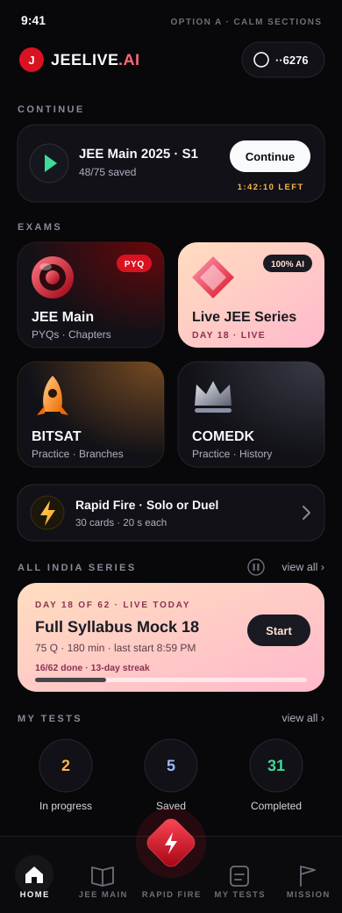
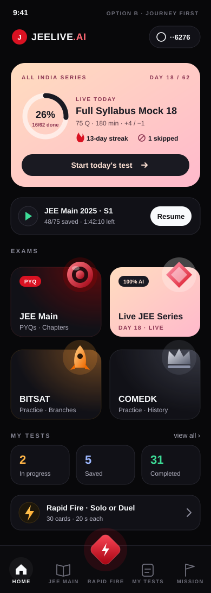
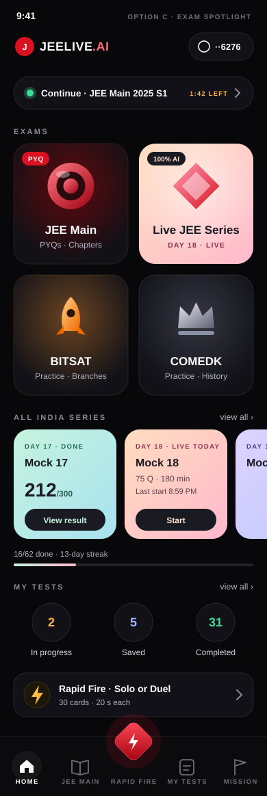
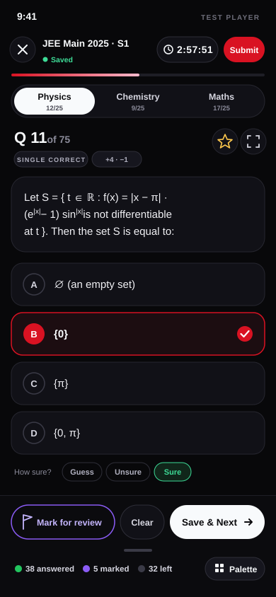
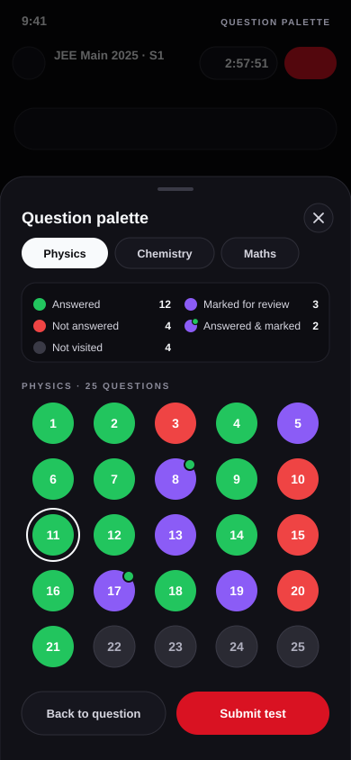
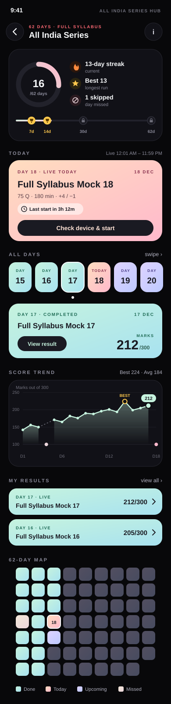

# Home ke 3 naye options (CRED + Wit Circle se inspired)

Teeno options mein ye cheezein same hain:
- Dark look, JEELIVE laal rang aur Figtree font.
- 2×2 exam grid, aapki 3D art aur PYQ / 100% AI badges ke saath. Mockup mein art saadi shapes se dikhayi gayi hai; app mein aapki asli 3D art hi rahegi.
- All India ke cards soft pastel gradient mein, status ke hisaab se rang:
  - Aaj = peach-rose
  - Ho gaya = mint
  - Aane wala = lavender
  - Chhoot gaya = sand
- Naya bottom bar, beech mein diamond Rapid Fire button ke saath.
- Koi search bar ya shortcut pills nahi.
- Mockups mein dikhaye gaye number (Day 18, 212/300, 13-day streak) sirf example hain. App mein aapka asli data dikhega.

## Option A — Calm Sections (pehle chuna gaya, ab aur nikhra hua)

- Saaf, alag-alag sections: CONTINUE → EXAMS → Rapid Fire → ALL INDIA SERIES → MY TESTS.
- Exam tiles: art upar-baayein, naam neeche-baayein.
- All India banner pastel hai, "Start" button aur "16/62 done · streak" progress line ke saath.
- My Tests: teen gol counters.
- Feel: shaant aur CRED jaisa.

## Option B — Journey First (aapki taiyari ki kahani sabse upar)

- Sabse upar ek bada pastel All India card: Apple Fitness jaisi progress ring (26% · 16/62), aaj ka test, streak, skipped din, aur bada "Start today's test" button.
- Phir ek patli Continue row, "Resume" button ke saath.
- Exam tiles: 3D art tile ke upar-daayein kone se bahar "uchhalti" dikhti hai (premium 3D feel). Naam neeche-baayein.
- My Tests: teen chhote stat cards.
- Feel: motivating. Student ko roz pehli nazar mein apni progress dikhti hai.

## Option C — Exam Spotlight (Wit Circle jaise bade tiles)

- Sabse upar ek patli "Continue" pill, jismein hara dot aur bacha hua samay hai.
- Exam tiles lambe hain: badi 3D art beech mein, peeche exam rang ki halki roshni (spotlight), aur naam neeche beech mein.
- All India: side-swipe hone wale din ke pastel cards. Kal ka result mint mein, aaj ka test peach mein, kal aane wala lavender mein. Neeche progress line.
- My Tests: teen gol counters.
- Feel: bold aur visual. Exams sabse bade dikhte hain.

---

Saath mein test screen aur All India hub ke mockups bhi hain, dekhne ke liye (inke liye koi choice nahi karni):
- Test dene wali screen: 
- Question palette: 
- All India Series hub: 
